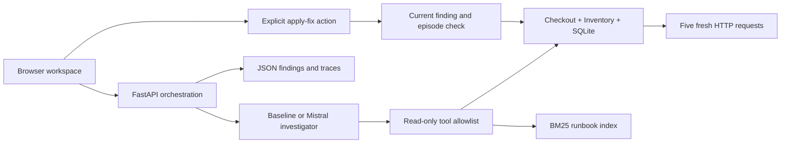

# IncidentLab

Investigate a failing checkout application, inspect the evidence, apply a proposed
fix to a disposable lab, and verify recovery against fresh HTTP requests.

This first version has a FastAPI backend, a responsive browser interface, two
real local HTTP services, a SQLite catalog, runbook retrieval, a deterministic
offline baseline, and a bounded Mistral tool-calling adapter.

**Offline baseline results are not Mistral model performance.** Live Mistral
evaluation requires your API key. See [STATUS.md](STATUS.md) for measured results
and remaining work.

## Run locally

Requires Python 3.11+ and [uv](https://docs.astral.sh/uv/).

```sh
uv sync --frozen --extra dev
uv run incidentlab
```

Open <http://127.0.0.1:8000>. The baseline works without an API key. The process
needs permission to bind loopback HTTP ports. One app process owns one lab;
run a single worker. Use `--port 8001` if 8000 is occupied.

Docker Desktop / Docker Engine with Compose is an alternative:

```sh
docker compose up --build -d app
```

The port is published only on loopback. Stop with `docker compose stop app`.
The named `lab-runtime` volume retains investigation exports across restarts.
This is a local demo without user authentication, not a public service.

## Try the complete workflow

1. Choose **Configuration drift**, then **Inject scenario**. Four checkout
   requests should fail with HTTP 502 because inventory returns HTTP 404.
2. Select **Offline baseline** and **Run investigation**.
3. Open the log and deployment evidence. Click a citation to jump to its record.
4. Select **Apply fix & verify**. The lab restores the inventory route and sends
   five new requests. Recovery requires all five to return HTTP 200.
5. Investigate again to confirm the healthy request window. Export the JSON
   record to retain the finding, tools, observations, and recovery result.

Also try **Missing evidence**: the investigator should abstain and propose no
action. A successful process liveness check alone never establishes checkout
readiness. See [the demo script](docs/DEMO.md).

## Use Mistral

Export `MISTRAL_API_KEY` in the server's environment and restart the app. Do not
put it into browser code. `MISTRAL_MODEL` defaults to `mistral-small-latest`;
pin an available provider model version for repeatable comparisons.

For Compose, copy `.env.example` to `.env` and fill it in locally. Compose reads
that file; the Python CLI does **not** automatically load `.env`. Keep `.env`
untracked. The browser only receives a configured/not-configured flag.

| Mode | Initial observations | Retrieval | Model-directed tools |
| --- | --- | --- | --- |
| `baseline` | Metrics, logs, health, changes | Lexical BM25 | None; deterministic rules |
| `prompt` | Three checkout logs and metrics | None | None |
| `retrieval` | Same initial snapshot | One BM25 search | None |
| `mistral` | Same initial snapshot | Available as a tool | Up to 16 calls across 8 API turns |

All model modes require a live API key; errors never silently fall back to the
baseline. The implementation follows Mistral's [function-calling
interface](https://docs.mistral.ai/studio/conversations/function-calling).
Model runs record tokens, latency, and optionally estimated cost using your
configured input/output prices. With no prices, cost remains unknown.

## Verify and evaluate

```sh
uv run --extra dev pytest -q
uv run incidentlab-eval --mode baseline --split smoke
uv run incidentlab-eval --mode baseline --split test
```

Or with Docker:

```sh
docker compose --profile test run --build --rm test
docker compose --profile eval run --build --rm eval incidentlab-eval --mode baseline --split test
```

On Linux, prefix the evaluation command with `LOCAL_UID="$(id -u)"
LOCAL_GID="$(id -g)"` if the mounted artifact directory has different ownership.

The frozen manifest has 7 smoke cases, 21 development cases, and 105 test cases.
These are **known single-fault regression cases**, including healthy and missing
telemetry controls. Seed splits do not establish generalization to unseen fault
families. Each run creates real traffic and saves per-case findings, traces,
recovery responses, manifest hash, and environment metadata in `artifacts/`.
See [evaluation methodology](docs/EVALUATION.md).

To compare model modes after configuring credentials:

```sh
uv run incidentlab-eval --mode prompt --split test
uv run incidentlab-eval --mode retrieval --split test
uv run incidentlab-eval --mode mistral --split test
```

These commands make paid API calls. Each complete test run has 105 cases.
Start with `--split smoke` to check the integration.

## How it works



The investigator receives observations, not the injected scenario or expected
answer. Operator controls and evaluation ground truth stay outside its context.
Tools cannot execute arbitrary code or remediate. The API accepts a remediation
only when it matches the current finding and lab revision; older findings and
repeat actions are rejected. Mutating workflows are serialized per lab.

Diagnosis validation checks typed output, allowed cause/action pairs, and
observed citation IDs. It does **not** prove that every claim follows from those
citations. Runbook text is guidance, never evidence that a failure happened.

FastAPI's [lifespan mechanism](https://fastapi.tiangolo.com/advanced/events/)
owns the HTTP lab and shuts it down when the app stops. After a fix, the lab starts
a new observation window so old failed requests cannot contaminate verification.

| Path | Purpose |
| --- | --- |
| `src/incidentlab/lab.py` | Real HTTP/SQLite lab and seven controlled scenarios |
| `src/incidentlab/investigator.py` | Offline rules and Mistral adapter |
| `src/incidentlab/tools.py` | Typed tool schemas, evidence collection, BM25 |
| `src/incidentlab/service.py` | Episode lifecycle, action checks, artifact storage |
| `src/incidentlab/api.py` | API and static interface |
| `src/incidentlab/static/` | Buildless browser UI; no CDN dependencies |
| `src/incidentlab/evaluate.py` | Frozen-suite runner and trace reports |
| `tests/` | Real-HTTP integration tests and mocked Mistral contract tests |

API documentation is at `/docs`. Local records are in
`runtime/investigations/`. The current incident and selected finding are
in-memory; saved JSON records survive restart, but they cannot be replayed as
remediation authorization. The browser workspace shows the current session and
does not yet provide a history browser.

## Next increments

Run the live Mistral comparison, add ambiguous timeout and multi-fault cases,
review semantic support manually, and gather feedback from two or three
engineers. PostgreSQL/Redis fault families and a production telemetry integration
are subsequent extensions. The initial scope decision is in
[docs/DECISION.md](docs/DECISION.md).
