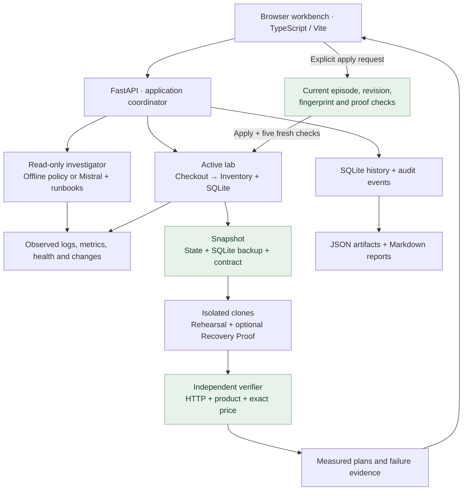
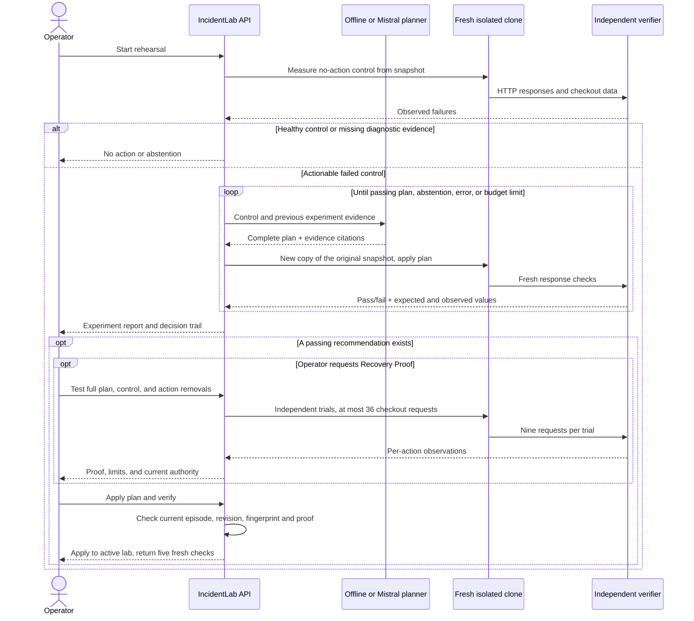

# IncidentLab

**A working checkout is more than an HTTP 200.**

IncidentLab is a local incident-response workbench. It investigates a deliberately
faulty checkout service, rehearses fixes in isolated copies, and verifies the
returned product and price before declaring recovery. An optional Mistral agent
can choose experiments; independent checks and an operator control what gets applied.

[Start the app](#quick-start) · [Try the demo](#try-the-demo) ·
[Explore the architecture](#architecture) · [Inspect the evidence](#measured-results)


*Recorded contract-aware dashboard. This capture predates the TypeScript migration;
the current build also includes Recovery Proof.*

## Contents

- [What you can use it for](#what-you-can-use-it-for)
- [Quick start](#quick-start)
- [Try the demo](#try-the-demo)
- [Architecture](#architecture)
- [Recovery Proof](#recovery-proof)
- [Measured results](#measured-results)
- [Run the checks](#run-the-checks)
- [Security and scope](#security-and-scope)
- [Repository map](#repository-map)

## What you can use it for

| Use case | What the workbench provides |
| --- | --- |
| Practice incident investigation | Reproducible failures, real HTTP services, logs, metrics, health checks, and cited findings. |
| Catch a false recovery | An independent checkout contract checks products and exact prices, including HTTP 200 responses with wrong totals. |
| Compare repair strategies | An offline policy, bounded Mistral experiments, or exhaustive comparison of five single fixes and ten pairs. |
| Explain a proposed repair | Recovery Proof removes each action in turn and measures whether the plan still works. |
| Review an agent integration | Retained failures, tool decisions, request budgets, provider usage, and reproducible evaluation protocols. |
| Keep an incident record | SQLite history, JSON evidence and proof exports, and Markdown incident reports. |

The lab has **12 scenarios**: six single faults, four compound failures, and
healthy/missing-evidence controls. Faults include route drift, dependency outages,
tight timeouts, missing catalogs, and explicit or silent pricing regressions.
The complete offline workflow needs **no API key**.

## Quick start

Install Docker with Compose, then:

```sh
git clone https://github.com/amithkm9/IncidentLab.git
cd IncidentLab
docker compose up --build -d app
```

Open **<http://127.0.0.1:8000>**. Docker builds both the TypeScript frontend and
Python backend. Stop with `docker compose stop app`; the `lab-runtime` volume
preserves history. API documentation is available at `/docs`.

<details>
<summary><strong>Local development: Python, TypeScript, and uv</strong></summary>

Requires Python 3.11+, Node.js 24+, npm, and [uv](https://docs.astral.sh/uv/).

```sh
make bootstrap
make run
```

Bootstrap runs the locked npm install, builds `frontend/dist`, then installs the
locked Python development dependencies. Build the frontend before installing or
packaging Python: the wheel includes that same UI.

For Vite's development server, keep the backend running and use a second terminal:

```sh
make dev
```

Open the URL Vite prints; `/api` requests proxy to the backend at port 8000.
One app process owns one lab, so use a single worker. If port 8000 is occupied,
use `uv run incidentlab --port 8001` and adjust the Vite proxy when needed.
The host must permit loopback HTTP ports. [Setup troubleshooting](docs/development/README.md#troubleshooting-setup)

</details>

<details>
<summary><strong>Optional live Mistral setup, budgets, and cost accounting</strong></summary>

For Compose, copy `.env.example` to `.env`, set `MISTRAL_API_KEY` locally, and
restart the app. Keep `.env` untracked. For the Python CLI, export the key in the
server environment; the CLI does not load `.env` automatically.

`MISTRAL_MODEL` defaults to `mistral-small-latest`. Pin an available model version
for a comparison. Choose **Adaptive · Mistral agent** in Fix rehearsal. This makes
paid provider requests. Credentials stay on the server; the browser receives
only the configuration flag and model name.

Adaptive rehearsal defaults to four candidate experiments with at most two
actions each. The API permits one to eight candidates and enforces a 120-second
scheduling deadline. The model uses Mistral Conversations with `store: false` and
the allowlisted `rehearse_plan` / `stop_rehearsal` functions. Measured trial outcomes
inform the next request. Invalid decisions and provider errors authorize no new
plan and never silently fall back to an offline success.

Investigation also supports `baseline`, `prompt`, `retrieval`, and `mistral`
modes. Model-directed investigation is bounded to eight API turns and 16 tool
calls. The baseline is an engineered offline policy, not a model.

Token and latency records remain in exports. Dollar estimates require configured
`MISTRAL_INPUT_USD_PER_MILLION` and `MISTRAL_OUTPUT_USD_PER_MILLION`; otherwise cost
is unknown. Failed calls may have usage the provider did not report.
[Provider integration and limitations](docs/career/mistral-fde.md)

</details>

## Try the demo

A missing inventory route hides a pricing bug. The first repair restores HTTP
200, but a notebook costs **$13.00 instead of $12.00**. The contract rejects that
partial repair; the complete plan also rolls back the pricing release.

1. Select **Try the silent-failure demo**. It injects `route_and_price_drift`
   at seed 42 and runs the first offline investigation.
2. Open a citation. Checkout returns 502; the evidence shows the dependency's
   missing route and HTTP 404.
3. In **Fix rehearsal**, run **Adaptive · offline policy** with the default
   four-experiment budget and two-action limit. Inspect the route-only trial:
   HTTP succeeds, but expected-versus-observed prices fail.
4. Follow the decision trail into the combined route repair and rollback.
   Each trial starts from the original snapshot, so it must include both repairs.
5. Select **Explain why each fix is needed** to run the optional Recovery Proof.
   Compare the full plan, unchanged control, and each action removal.
6. Select **Apply plan & verify**. The server rechecks the current state, then
   applies the plan and checks five fresh active-lab requests. Export the proof,
   experiment JSON, and incident report; reopen history to inspect the record.

The declared products are notebook ($12.00), lamp ($45.00), and mug ($8.50).
Default three-request trials and five-request final verification cover all three.

<details>
<summary><strong>Explore experiment budgets, all plans, and no-action controls</strong></summary>

Repeat the demo with **Experiment budget = 1**. The route-only repair exposes
incorrect prices, so no passing plan is available to promote. Increase the
ceiling to four and rerun against the unchanged source.

Select **Compare all plans** to measure the no-change control, each individual
fix, and the action pairs. Use **Show → Passed** to inspect successes, then
return to **All outcomes** to keep failed experiments visible.

Try **Healthy control** and **Missing evidence**. Both should recommend no
mutation: healthy traffic needs no fix, while absent telemetry requires
abstention. Restarting preserves history but creates a new episode; old plans
remain read-only. Live Mistral decisions can differ from this offline demo;
its measured failures are reported below.

</details>

## Architecture

**Python 3.11+ · FastAPI · SQLite · TypeScript · Vite · BM25 runbooks · optional Mistral**

The application uses actual checkout and inventory HTTP servers plus a SQLite
catalog. Its failures are controlled lab mechanisms. Every rehearsal clone gets
the same actual-state snapshot, including partial repairs already made; it does
not use the scenario label as a repair answer key.



The investigator can observe but cannot mutate the lab. The planner can choose
allowed experiments but cannot change the independent contract or promote its
own plan. A passing experiment becomes a recommendation; an explicit operator
request and current-state checks are still required to apply it.



Records persist in `runtime/history.sqlite`. Reloads restore the workspace;
server restarts create a new lab episode while retaining read-only history.
[Component map and exact interfaces](docs/architecture/overview.md) ·
[Contract specification](docs/architecture/semantic-recovery.md)

## Recovery Proof

A passing plan says what worked. Recovery Proof asks **what happens if one fix
is removed?** It compares the full plan with an unchanged control and each
leave-one-action-out variant, all from the same snapshot. It makes **zero model
calls** and does not modify the active lab.

| Plan | Trials | Checkout requests |
| --- | --- | ---: |
| One action | Control + full plan; the control also represents removal of the action | 18 |
| Two actions | Control + full plan + each action removed | 36 |

Each trial checks all three products three times. A failed measurement stops the
run; exports distinguish completed trials from potentially partial failed traffic.
The five post-promotion requests are separate from this budget.

The [recorded guided proof](docs/evaluation/results/recovery-proof-route-price.json)
completed all four trials with the source unchanged:

| Trial | HTTP outcome | Contract outcome |
| --- | --- | --- |
| No changes | 9 × 502 | Failed |
| Route repair + rollback | 9 × 200 | Passed |
| Without route repair | 9 × 502 | Failed |
| Without rollback | 9 × 200 | Failed: nine incorrect prices |

This supports necessity **within that measured plan and snapshot**. It does not
establish global minimality, a unique cause, or production safety. If removing an
action also passes, the report identifies redundancy; the passing full plan can
still be eligible. An incomplete or failed proof blocks that rehearsal's promotion.

Proof is optional, but once requested its failure cannot be bypassed by promoting
the same rehearsal. Exported SHA-256 digests are **unsigned**: they detect changes
against a trusted digest, not who authored the artifact. Current authority is
recomputed separately; a saved proof never authorizes a change in a new episode.
[Full proof protocol and authority rules](docs/architecture/recovery-proof.md)

## Measured results

Results use small, controlled, known-fault cases. They are not production incidents,
MTTR measurements, or evidence of generalization to unseen failures. Unsuccessful
cases and provider errors remain in the denominators.

| Measurement | Recorded result | Evidence |
| --- | --- | --- |
| HTTP-only vs contract acceptance on identical responses | 72 paired trials / 216 requests; HTTP accepted 39, contract accepted 30. **9/39 HTTP acceptances were false recoveries (23.08%).** | [Offline export](docs/evaluation/results/semantic-offline-results.json) |
| Separate offline adaptive recovery arm | **12/12 faults recovered**, **6/6 no-action controls**, 18 candidate experiments, zero provider calls | [Semantic protocol](docs/evaluation/semantic-evaluation.md) |
| Live `mistral-small-2603`, initial smoke | **1/4 faults recovered**, 2/2 controls, two provider errors; a compound plan omitted a required prior repair | [Initial live export](docs/evaluation/results/semantic-mistral-initial-results.json) |
| Same pinned model, context follow-up | **1/4 faults recovered**, 2/2 controls, three HTTP 429 failures; no demonstrated recovery-quality improvement | [Follow-up export](docs/evaluation/results/semantic-mistral-followup-results.json) |

The paired acceptance test and policy recovery test answer different questions.
Offline results describe engineered rules, not Mistral accuracy. Both live traces
are retained; no live quality improvement is claimed.

<details>
<summary><strong>Historical HTTP-status results · October 17, 2026</strong></summary>

These runs predate business-contract checks and the silent-price scenarios.
Recovery meant five fresh HTTP 200 responses.

| Comparison | Recorded result | Budget and scope |
| --- | --- | --- |
| Single-fault baseline | 105/105 correct causes/actions; 75/75 recoveries; 30/30 no-action controls | [Frozen baseline cases](docs/evaluation/baseline-results.md) |
| Exhaustive rehearsal vs one proposed fix | 24/24 vs 15/24 fault recoveries; 9/9 vs 0/9 compound recoveries; both 6/6 controls | 405 candidates and 1,305 rehearsal requests; larger search budget. [Protocol](docs/evaluation/rehearsal-evaluation.md) |
| Offline adaptive vs fixed-order search | 24/24 vs 12/24 fault recoveries; 33 vs 78 candidates; both 6/6 controls | Same candidate ceiling; deliberately simple ordered comparator. [Protocol](docs/evaluation/adaptive-evaluation.md) |

Exhaustive rehearsal's median complete episode time was 1,717.40 ms versus
15.72 ms for the one-shot baseline. The improved recovery rate costs more work;
it is not a measured reduction in real incident resolution time. Historical
[rehearsal](docs/evaluation/results/rehearsal-results.json) and
[adaptive](docs/evaluation/results/adaptive-results.json) artifacts are unchanged.

</details>

## Run the checks

```sh
# Full local quality checks after make bootstrap
make check

# Backend integration suite when the host restricts loopback HTTP
docker compose --profile test run --build --rm test

# Reproduce semantic acceptance and offline recovery measurements
docker compose --profile eval run --build --rm eval \
  incidentlab-semantic-eval --split test --strategies adaptive

# Equal-ceiling adaptive versus fixed-order comparison
docker compose --profile eval run --build --rm eval \
  incidentlab-adaptive-eval --seeds 11,23,37 --max-experiments 4
```

New full reports go to ignored `artifacts/`; published summaries live under
`docs/evaluation/results/`. The separate single-fault manifest has 7 smoke,
21 development, and 105 test cases. Live semantic/adaptive comparisons require
credentials and explicit `--allow-paid-api` opt-in. Mocked provider tests incur
no model charges. [Protocols](docs/README.md#evaluation) · [Latest validation](STATUS.md)

## Security and scope

This is a **local demo without authentication or tenant isolation**. Compose
binds the UI to loopback. Run a single process and do not expose this configuration
as a public service. Credentials belong only in the server environment or ignored
`.env`, never frontend code or committed artifacts.

Only allowlisted lab actions can run. Scenario labels and evaluator answers stay
outside model observations. Independent response validation, bounded experiments,
and stale-state checks constrain this workflow; citation validation does not
prove every model statement follows from its evidence.

The API checks loopback Host names and full browser origins, bounds request bodies
to 64 KiB, prevents API caching, and returns sanitized errors. The frontend checks
response shapes before accepting state and disables mutations after a failed
refresh. These controls supplement the local-only scope; they do not add user
authentication. [Security review, fixes, and scan limits](docs/development/codebase-audit.md)

The contract covers declared product, price, and response-shape requirements.
It does not verify unspecified business rules, side effects, long-term reliability,
or production rollout safety. Clones are copies of this purpose-built HTTP/SQLite
application, not arbitrary production infrastructure. Next work includes broader
invariants, stronger comparison policies, provider-failure handling, and engineer
feedback. Production telemetry adapters require separate engineering.

## Repository map

```text
frontend/                     TypeScript source, local assets, tests, Vite build
src/incidentlab/
├── api/                      HTTP routes, browser security, frontend delivery
├── domain/                   Shared models and independent contracts
├── lab/                      HTTP services, scenarios, snapshots
├── investigation/            Investigator adapters, tools, runbooks
├── recovery/                 Rehearsal, adaptive planning, Recovery Proof
├── evaluation/               Offline/live comparisons and frozen manifests
├── application.py            Workflow coordination and promotion authority
├── storage.py                SQLite records and audit events
└── cli.py                    Application entrypoint
tests/                        Tests grouped around those responsibilities
docs/                         Technical references, protocols, and recorded results
```

Edit `frontend/src`; Vite generates the ignored `frontend/dist`. Wheels include
that build as `incidentlab/web`. `make build` creates the frontend and Python
distributions. Dependency lockfiles are tracked; generated builds, caches, local
runtime state, and private credentials are not.

[Contributing](CONTRIBUTING.md) · [Documentation index](docs/README.md) ·
[Design history](docs/architecture/scope-decision.md) ·
[CV claims with evidence](docs/career/cv.md) · [Project status](STATUS.md)
