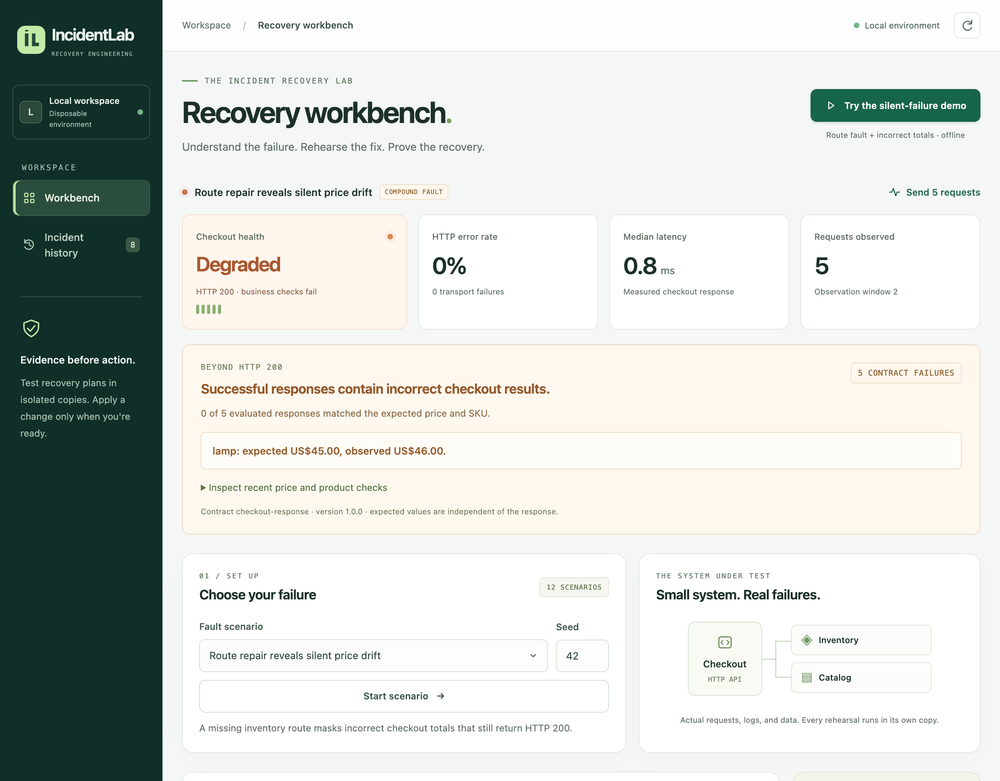
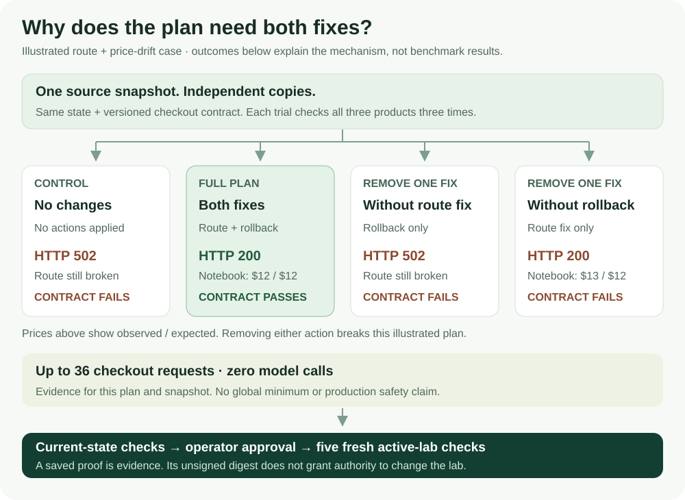
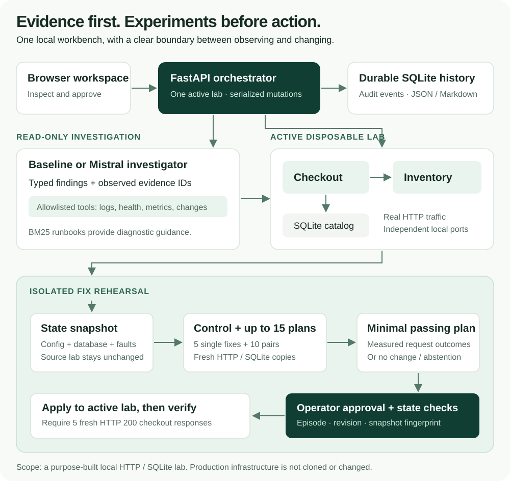
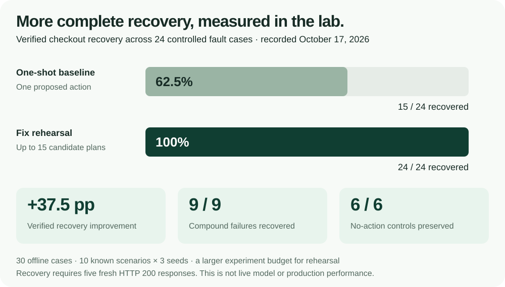
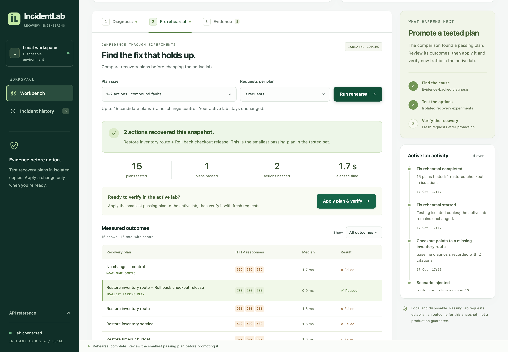

# IncidentLab

**Understand the failure. Rehearse the fix. Verify the business outcome.**

IncidentLab is a local incident workbench that checks whether checkout is both
available and correct. It investigates failures, tests recovery plans in isolated
copies, and verifies returned prices and product IDs before calling a fix successful.


[Run locally](#run-locally) · [See the workflow](#from-incident-to-recovery) ·
[Explore the architecture](#how-it-works) · [Read the results](#measured-results)



*The contract-aware workbench, captured from the running app.*

## From incident to recovery

A broken inventory route can hide an overcharge. Repairing the route returns
HTTP 200 while a notebook costs **$13.00 instead of the required $12.00**. The
versioned checkout contract rejects that partial repair and gives the planner
concrete evidence for the next experiment.

Click **Try the silent-failure demo**, then run **Adaptive · offline policy** in
**Fix rehearsal**. Inspect the failed price check, compare the combined route
repair and release rollback, then approve the measured plan. Five fresh requests
must pass both HTTP and business-contract checks.
[Follow the demo →](docs/guides/DEMO.md) · [Understand semantic recovery →](docs/architecture/SEMANTIC_RECOVERY.md)

| What you can do | What makes it useful |
| --- | --- |
| Follow a diagnosis into its evidence | Inspect the actual logs, health responses, metrics, and changes behind a finding. |
| Detect a false recovery | Compare returned totals and product IDs with an independent, versioned contract—even when HTTP succeeds. |
| Compare fixes before changing the lab | Use bounded adaptive experiments or compare all five individual fixes and ten pairs against a no-action control. |
| Test what each fix contributes | Run Recovery Proof: replay the full plan, remove one action at a time, and inspect which contract checks fail. |
| Approve a measured recovery plan | Promote a passing tested plan only while its source state and contract are still current. |
| Keep an inspectable incident record | Reopen SQLite-backed history and export evidence, experiments, and verification as JSON or Markdown. |

Twelve scenarios cover route drift, dependency outages, tight timeouts, missing
catalogs, explicit and silent pricing regressions, **four compound failures**,
and healthy or missing-evidence controls. The offline workflow needs no API key;
Mistral adds bounded investigation and adaptive experiment selection.

## Recovery Proof: what happens if a fix is removed?

After a passing rehearsal, select **Explain why each fix is needed**. Recovery
Proof measures the full plan, an unchanged control, and each action-removal
variant from the same snapshot. It uses at most **36 checkout requests** and
**zero model calls**; the active lab stays unchanged.



In the [recorded guided run](docs/evaluation/results/recovery-proof-route-price.json),
four trials completed **36 responses** with the source unchanged. The full plan
passed; removing the route fix returned HTTP 502, while removing rollback
returned nine HTTP 200 responses with nine incorrect prices. No model calls
were made. This is one measured local example.

The result can support an action's necessity within this measured plan, expose
a redundant action, or fail to support promotion. It does not establish a global
minimum or production safety. The exported digest is unsigned, and the server
rechecks current authority before any promotion. Proof is optional; once run,
its failure cannot be bypassed on the same rehearsal.
[Measurement, integrity, and authority boundaries →](docs/architecture/RECOVERY_PROOF.md)

## Adaptive recovery with Mistral

The planner chooses an experiment, observes its measured result, and uses newly
exposed failure evidence to choose the next plan. Contract violations supply
expected and observed amounts, product IDs, and evidence citations. Each trial
starts from the same source snapshot, so a complete plan must retain every
repair it needs.

In **Fix rehearsal**, select **Adaptive · offline policy** to try it without an
API key, or **Adaptive · Mistral agent** after configuring the server key. The
Mistral mode uses the Conversations API with local function execution. Each run
records its experiment decisions, budget, measured outcomes, and provider usage.
Failed or invalid model decisions never fall back to an offline success.

The independent verifier decides whether a measured plan passed. The model can
choose an allowed experiment or abstain; it cannot waive contract failures or
promote a change. [Integration, evaluation, and customer-pilot approach →](docs/career/MISTRAL_FDE.md)

## How it works

The investigator reads evidence. The rehearsal engine tests changes in temporary
copies. An explicit operator action is required to apply the selected plan to
the active lab.



**Stack:** Python 3.11+ · FastAPI · SQLite · real HTTP services · strict
TypeScript / Vite / CSS · BM25 runbooks · optional Mistral API.

The lab is a purpose-built local application. Each rehearsal copies its current
state, including partial repairs; it does not use the injected scenario label to
choose a fix. The source lab stays unchanged during experiments. Before
promotion, the API checks the episode, revision, and a SHA-256 state fingerprint
that includes the contract definition. Fresh verification checks both HTTP
availability and the declared business rules.

[Architecture, component map, and design boundaries →](docs/architecture/ARCHITECTURE.md)

## Measured results

The new [semantic-recovery evaluation](docs/evaluation/SEMANTIC_EVALUATION.md) scores
HTTP-only and contract-aware acceptance against the **same recorded responses**,
then separately measures selected recovery plans in independent labs. Failed
cases stay in the denominators, with decisions, errors, requests, latency, and
provider usage retained.

In the recorded offline test, **72 paired trials** produced **39 HTTP-only
acceptances**, of which **nine were false recoveries** under the contract
(23.08%). Contract checks accepted 30. Separately, the offline adaptive policy
recovered **12/12 fault episodes**, preserved **6/6 no-action controls**, and
used **18 candidate experiments**. These are controlled known-scenario results,
not model accuracy or production incidents.

The first live smoke run with pinned **`mistral-small-2603`** recovered **1/4
fault cases**, preserved **2/2 no-action controls**, and recorded **two provider
errors**. A compound case exposed a planning error: the model omitted a repair
needed by the original snapshot. A follow-up with clearer experiment context also recovered **1/4 faults** and
recorded **three HTTP 429 failures**. Both runs are retained; no live quality
improvement or production readiness is claimed.
[Run details and subsequent evidence →](docs/evaluation/SEMANTIC_EVALUATION.md)

<details>
<summary><strong>Historical offline results · October 17, 2026 · HTTP-status recovery</strong></summary>





*Earlier HTTP-only comparison screen; current runs also expose business-contract checks.*

The recorded comparison contains **30 cases: 24 faults and six controls** across
ten known scenarios and three seeds. Rehearsal recovered all nine compound-fault
cases that the one-shot baseline left partially repaired.

This improvement uses a larger budget: **405 candidate experiments and 1,305
rehearsal requests**. Median complete episode time was 15.72 ms for the baseline
and 1,717.40 ms for rehearsal. These are repeated, controlled offline cases—not
Mistral accuracy, independent production incidents, or a claim of reduced MTTR.
Recovery in this historical run meant five fresh HTTP 200 responses. These
artifacts predate business-contract checks and the two silent-price scenarios.

A separate historical offline adaptive run recovered **24/24 fault episodes
with 33 candidates**, including nine compound cases, and preserved **6/6
no-action controls**. It tested an engineered known-error policy against a simple
fixed-order comparator. [Adaptive protocol and limits →](docs/evaluation/ADAPTIVE_EVALUATION.md)

[Protocol and recorded results](docs/evaluation/REHEARSAL_EVALUATION.md) ·
[Machine-readable summary](docs/evaluation/results/rehearsal-results.json) ·
[CV-ready engineering claims](docs/career/CV.md)

</details>

## Run locally

With Docker Desktop or Docker Engine and Compose:

```sh
git clone https://github.com/amithkm9/IncidentLab.git
cd IncidentLab
docker compose up --build -d app
```

Open **<http://127.0.0.1:8000>**. No API key is needed for the offline workflow.
Stop the app with `docker compose stop app`. The named `lab-runtime` volume
preserves saved history across restarts.

<details>
<summary><strong>Develop locally with Python, TypeScript, and uv.</strong></summary>

Requires Python 3.11+, Node.js 24+, npm, and [uv](https://docs.astral.sh/uv/).

```sh
make bootstrap
uv run incidentlab
```

The process must be able to bind loopback HTTP ports. One app process owns one
lab, so run a single worker. Use `uv run incidentlab --port 8001` if port 8000 is
occupied.

Bootstrap installs the locked frontend dependencies, builds `frontend/dist`,
then installs the Python package. The build is also included in Python wheels
and Docker images. See the [development guide](docs/development/README.md) for
the Vite development server and quality checks.

</details>

<details>
<summary><strong>Enable Mistral investigation and adaptive rehearsal.</strong></summary>

Export `MISTRAL_API_KEY` in the server environment, then restart. For Docker
Compose, copy `.env.example` to `.env` and fill it in locally. Keep that file
untracked. The Python CLI does not automatically load `.env`.

`MISTRAL_MODEL` defaults to `mistral-small-latest`. Pin an available provider
version for repeatable comparisons. Credentials stay on the server; the browser
receives only a configured/not-configured flag. Live model use makes paid API
calls. Live smoke results and offline results are reported separately above.

[Investigation modes, budgets, and cost accounting →](docs/architecture/ARCHITECTURE.md#investigation-modes)

</details>

This is a local demo without user authentication. Docker exposes it only on
loopback; it is not configured as a public service. API documentation is available
at `/docs`.

## Verify it yourself

```sh
# Real-HTTP integration tests and mocked model contract tests
docker compose --profile test run --build --rm test

# Compare HTTP-only acceptance with contract-verified recovery
docker compose --profile eval run --build --rm eval \
  incidentlab-semantic-eval --split test --strategies adaptive

# Compare adaptive selection and fixed-order search at the same candidate ceiling
docker compose --profile eval run --build --rm eval \
  incidentlab-adaptive-eval --seeds 11,23,37 --max-experiments 4
```

Full per-case evidence is saved under `artifacts/`. The existing single-fault
suite separately contains 7 smoke, 21 development, and 105 regression cases.
These suites exercise known fault families; seed splits do not establish
generalization to unseen incidents.

[All validation commands](docs/architecture/ARCHITECTURE.md#validation-and-evaluation) ·
[Single-fault evaluation methodology](docs/evaluation/EVALUATION.md) ·
[Documentation map](docs/README.md) ·
[Contributing](CONTRIBUTING.md) ·
[Project status](STATUS.md) · [Original scope decision](docs/architecture/DECISION.md)

Next work targets the observed live-model failure modes, a stronger iterative
baseline, additional business invariants, and engineer feedback. Production
telemetry adapters and deployment rollback require separate engineering.
