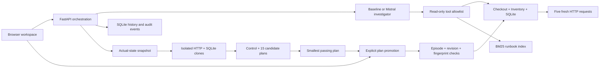

# IncidentLab

An incident recovery workbench that investigates failures, **rehearses fixes in
isolated copies**, and promotes a measured recovery plan to a disposable lab.

A single error can hide another: restoring an inventory route may reveal a
pricing regression. IncidentLab compares a no-action control, five individual
fixes, and ten two-action combinations against real HTTP requests. It recommends
the smallest passing plan and verifies it again after explicit promotion.

Built with FastAPI, real checkout/inventory HTTP services, SQLite, a buildless
responsive frontend, BM25 runbooks, deterministic offline investigation, and a
bounded Mistral tool-calling adapter. Ten scenarios include three compound faults
and healthy/missing-evidence controls.

**Offline baseline results are not Mistral model performance.** Live Mistral
evaluation requires your API key. See [STATUS.md](STATUS.md) for measured results
and remaining work.

## Run locally

Requires Python 3.11+ and [uv](https://docs.astral.sh/uv/).

```sh
uv sync --frozen --extra dev
uv run incidentlab
```

Open <http://127.0.0.1:8000>. The baseline works without an API key. The process
needs permission to bind loopback HTTP ports. One app process owns one lab;
run a single worker. Use `--port 8001` if 8000 is occupied.

Docker Desktop / Docker Engine with Compose is an alternative:

```sh
docker compose up --build -d app
```

The port is published only on loopback. Stop with `docker compose stop app`.
The named `lab-runtime` volume retains investigation exports across restarts.
This is a local demo without user authentication, not a public service.

## Try the complete workflow

1. Choose **Route drift masks a pricing regression** and **Start scenario**.
2. Run the **Offline baseline** investigation. Inspect the route failure and
   follow its citations into the Evidence tab.
3. Open **Fix rehearsal** and **Run rehearsal** with one or two actions. The
   active lab stays unchanged while 15 candidate plans and one control run in
   separate HTTP/SQLite copies.
4. Compare the responses: fixing only the route still leaves checkout broken.
   The smallest passing plan restores the route **and** rolls back pricing.
5. Select **Apply plan & verify**. The server checks the episode, revision, and
   snapshot fingerprint, then requires five fresh HTTP 200 responses.
6. Open **Incident history**, inspect the saved evidence, and download the JSON
   experiment record or Markdown incident report. Reloading the page preserves
   the current workspace; restarting the server preserves read-only history.

Try **Missing evidence** to see abstention and **Healthy control** to see a
no-change recommendation. The diagnosis can also apply its single proposed fix;
that workflow deliberately exposes incomplete recovery on compound incidents.
See [the demo script](docs/DEMO.md).

## Use Mistral

Export `MISTRAL_API_KEY` in the server's environment and restart the app. Do not
put it into browser code. `MISTRAL_MODEL` defaults to `mistral-small-latest`;
pin an available provider model version for repeatable comparisons.

For Compose, copy `.env.example` to `.env` and fill it in locally. Compose reads
that file; the Python CLI does **not** automatically load `.env`. Keep `.env`
untracked. The browser only receives a configured/not-configured flag.

| Mode | Initial observations | Retrieval | Model-directed tools |
| --- | --- | --- | --- |
| `baseline` | Metrics, logs, health, changes | Lexical BM25 | None; deterministic rules |
| `prompt` | Three checkout logs and metrics | None | None |
| `retrieval` | Same initial snapshot | One BM25 search | None |
| `mistral` | Same initial snapshot | Available as a tool | Up to 16 calls across 8 API turns |

All model modes require a live API key; errors never silently fall back to the
baseline. The implementation follows Mistral's [function-calling
interface](https://docs.mistral.ai/studio/conversations/function-calling).
Model runs record tokens, latency, and optionally estimated cost using your
configured input/output prices. With no prices, cost remains unknown.

## Verify and evaluate

```sh
uv run --extra dev pytest -q
uv run incidentlab-eval --mode baseline --split smoke
uv run incidentlab-eval --mode baseline --split test
uv run incidentlab-rehearsal-eval --split test
```

Or with Docker:

```sh
docker compose --profile test run --build --rm test
docker compose --profile eval run --build --rm eval incidentlab-eval --mode baseline --split test
docker compose --profile eval run --rm eval incidentlab-rehearsal-eval --split test
```

On Linux, prefix the evaluation command with `LOCAL_UID="$(id -u)"
LOCAL_GID="$(id -g)"` if the mounted artifact directory has different ownership.

The frozen manifest has 7 smoke cases, 21 development cases, and 105 test cases.
These are **known single-fault regression cases**, including healthy and missing
telemetry controls. Seed splits do not establish generalization to unseen fault
families. Each run creates real traffic and saves per-case findings, traces,
recovery responses, manifest hash, and environment metadata in `artifacts/`.
See [evaluation methodology](docs/EVALUATION.md).

The separate rehearsal comparison has **30 cases: 15 single faults, nine compound
faults, and six controls**. It compares one-shot baseline remediation with the
larger rehearsal workflow, saves both arms and every candidate outcome, and
retains failures in metric denominators. See [rehearsal evaluation and measured
results](docs/REHEARSAL_EVALUATION.md) and [CV-ready project claims](docs/CV.md).

To compare model modes after configuring credentials:

```sh
uv run incidentlab-eval --mode prompt --split test
uv run incidentlab-eval --mode retrieval --split test
uv run incidentlab-eval --mode mistral --split test
```

These commands make paid API calls. Each complete test run has 105 cases.
Start with `--split smoke` to check the integration.

## How it works



The investigator receives observations, not the injected scenario or expected
answer. Operator controls and evaluation ground truth stay outside its context.
Tools cannot execute arbitrary code or remediate. The API accepts a remediation
only when it matches the current finding and lab revision; older findings and
repeat actions are rejected. Mutating workflows are serialized per lab.

Diagnosis validation checks typed output, allowed cause/action pairs, and
observed citation IDs. It does **not** prove that every claim follows from those
citations. Runbook text is guidance, never evidence that a failure happened.

FastAPI's [lifespan mechanism](https://fastapi.tiangolo.com/advanced/events/)
owns the HTTP lab and shuts it down when the app stops. After a fix, the lab starts
a new observation window so old failed requests cannot contaminate verification.

| Path | Purpose |
| --- | --- |
| `src/incidentlab/lab.py` | Real HTTP/SQLite lab, ten scenarios, snapshot/clone lifecycle |
| `src/incidentlab/rehearsal.py` | Bounded intervention search and measured plan selection |
| `src/incidentlab/investigator.py` | Offline rules and Mistral adapter |
| `src/incidentlab/tools.py` | Typed tool schemas, evidence collection, BM25 |
| `src/incidentlab/service.py` | Episode lifecycle, promotion guards, report generation |
| `src/incidentlab/store.py` | Indexed SQLite history, atomic record/event transactions |
| `src/incidentlab/api.py` | API and static interface |
| `src/incidentlab/static/` | Buildless browser UI; no CDN dependencies |
| `src/incidentlab/evaluate.py` | Original frozen-suite runner and trace reports |
| `src/incidentlab/evaluate_rehearsal.py` | Single-fix versus rehearsal evaluation |
| `tests/` | Real-HTTP integration tests and mocked Mistral contract tests |

API documentation is at `/docs`. Records and append-only audit events are in
`runtime/history.sqlite`; v0.1 JSON exports are imported once without replacing
newer records. Current lab authority stays in memory. A server restart creates a
new episode, so historical fixes cannot authorize mutations of a new lab.

Rehearsal snapshots use SQLite's backup API and independent loopback ports. They
copy the **current state**, including partial repairs, without reading scenario
labels or expected actions. A SHA-256 state fingerprint detects changes between
rehearsal and promotion. Search is bounded to five known actions and at most two
per plan; it does not establish production safety or arbitrary fault recovery.

## Next increments

Run a credentialed Mistral comparison, add an equal-budget iterative diagnosis
baseline, assess semantic correctness beyond HTTP status, and collect engineer
feedback. Production telemetry adapters, richer databases, and real deployment
rollback require separate engineering. This version does not clone production
systems or claim new scientific causality methods. The original scope decision
is in [docs/DECISION.md](docs/DECISION.md).
