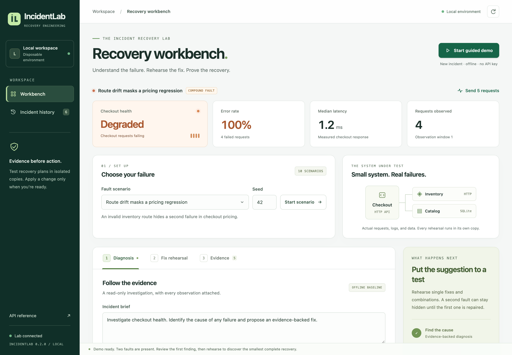
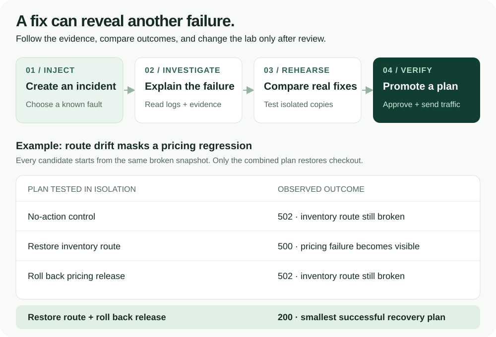
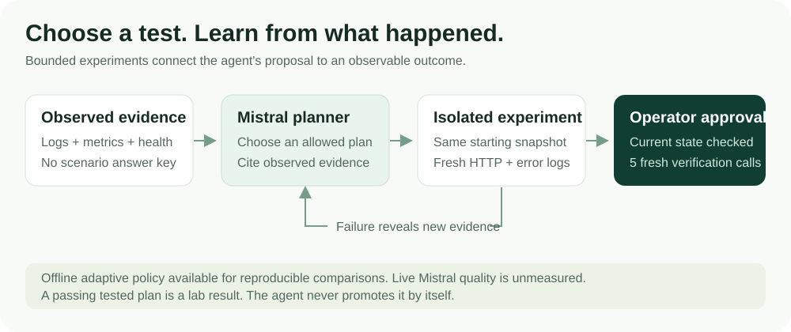

# IncidentLab

**Understand an incident. Rehearse the fix. Verify the recovery.**

IncidentLab is a local incident workbench that investigates broken services,
tests recovery plans in isolated copies, and lets you approve a measured fix.
It turns “this should work” into an experiment you can inspect.

[Run locally](#run-locally) · [See the workflow](#from-incident-to-recovery) ·
[Explore the architecture](#how-it-works) · [Read the results](#measured-results)



*The working app, captured locally. [View the mobile comparison screen →](docs/assets/mobile.png)*

## From incident to recovery

A broken inventory route can hide a second problem in pricing. Fix the route
alone and checkout still fails. IncidentLab makes that sequence visible:



Click **Start guided demo** to load this compound failure and its first diagnosis.
Run a two-action rehearsal, compare the unsuccessful single fixes,
then approve the combined plan. The app sends five fresh checkout requests to
verify the result. [Follow the complete demo →](docs/DEMO.md)


| What you can do | What makes it useful |
| --- | --- |
| Follow a diagnosis into its evidence | Inspect the actual logs, health responses, metrics, and changes behind a finding. |
| Compare fixes before changing the lab | Measure a no-action control, five individual fixes, and ten two-action combinations in isolated copies. |
| Approve a measured recovery plan | Promote the smallest successful plan only while its source state is still current. |
| Keep an inspectable incident record | Reopen SQLite-backed history and export evidence, experiments, and verification as JSON or Markdown. |

Ten scenarios cover route drift, dependency outages, tight timeouts, missing
catalogs, pricing regressions, three compound failures, and healthy or
missing-evidence controls. The offline investigator works without an API key;
Mistral adds bounded, read-only tool calling.

## Adaptive recovery with Mistral

The new planner chooses an experiment, observes its result, and uses newly
exposed failure evidence to choose the next plan. A route repair can reveal a
pricing exception; the next experiment can test both fixes together.



In **Fix rehearsal**, select **Adaptive · offline policy** to try it without an
API key, or **Adaptive · Mistral agent** after configuring the server key. The
Mistral mode uses the Conversations API with local function execution. Each run
records its experiment decisions, budget, measured outcomes, and provider usage.
Failed or invalid model decisions never fall back to an offline success.

The recorded offline adaptive run recovered **24/24 fault episodes with 33
candidate experiments**, including nine compound cases, and preserved all six
no-action controls. [Protocol and comparison limits →](docs/ADAPTIVE_EVALUATION.md)

**Live Mistral quality is not yet measured.** Offline policy scores and mocked
provider tests are labeled separately. [Integration, evaluation, and FDE demo →](docs/MISTRAL_FDE.md)

## How it works

The investigator reads evidence. The rehearsal engine tests changes in temporary
copies. An explicit operator action is required to apply the selected plan to
the active lab.


**Stack:** Python 3.11+ · FastAPI · SQLite · real HTTP services · HTML / CSS /
JavaScript · BM25 runbooks · optional Mistral API.

The lab is a purpose-built local application. Each rehearsal copies its current
state, including partial repairs; it does not use the injected scenario label to
choose a fix. The source lab stays unchanged during experiments. Before
promotion, the API checks the episode, revision, and a SHA-256 state fingerprint.

[Architecture, component map, and design boundaries →](docs/ARCHITECTURE.md)

## Measured results


The recorded comparison contains **30 cases: 24 faults and six controls** across
ten known scenarios and three seeds. Rehearsal recovered all nine compound-fault
cases that the one-shot baseline left partially repaired.

This improvement uses a larger budget: **405 candidate experiments and 1,305
rehearsal requests**. Median complete episode time was 15.72 ms for the baseline
and 1,717.40 ms for rehearsal. These are repeated, controlled offline cases—not
Mistral accuracy, independent production incidents, or a claim of reduced MTTR.
Recovery here means five fresh HTTP 200 responses.

[Protocol and recorded results](docs/REHEARSAL_EVALUATION.md) ·
[Machine-readable summary](docs/rehearsal-results.json) ·
[CV-ready engineering claims](docs/CV.md)

## Run locally

With Docker Desktop or Docker Engine and Compose:

```sh
git clone https://github.com/amithkm9/IncidentLab.git
cd IncidentLab
docker compose up --build -d app
```

Open **<http://127.0.0.1:8000>**. No API key is needed for the offline workflow.
Stop the app with `docker compose stop app`. The named `lab-runtime` volume
preserves saved history across restarts.

<details>
<summary><strong>Prefer Python? Run with uv.</strong></summary>

Requires Python 3.11+ and [uv](https://docs.astral.sh/uv/).

```sh
uv sync --frozen --extra dev
uv run incidentlab
```

The process must be able to bind loopback HTTP ports. One app process owns one
lab, so run a single worker. Use `uv run incidentlab --port 8001` if port 8000 is
occupied.

</details>

<details>
<summary><strong>Enable Mistral investigation and adaptive rehearsal.</strong></summary>

Export `MISTRAL_API_KEY` in the server environment, then restart. For Docker
Compose, copy `.env.example` to `.env` and fill it in locally. Keep that file
untracked. The Python CLI does not automatically load `.env`.

`MISTRAL_MODEL` defaults to `mistral-small-latest`. Pin an available provider
version for repeatable comparisons. Credentials stay on the server; the browser
receives only a configured/not-configured flag. Live model use makes paid API
calls and has not been benchmarked in the recorded offline results.

[Investigation modes, budgets, and cost accounting →](docs/ARCHITECTURE.md#investigation-modes)

</details>

This is a local demo without user authentication. Docker exposes it only on
loopback; it is not configured as a public service. API documentation is available
at `/docs`.

## Verify it yourself

```sh
# Real-HTTP integration tests and mocked model contract tests
docker compose --profile test run --build --rm test

# Reproduce the single-fix versus rehearsal comparison
docker compose --profile eval run --build --rm eval \
  incidentlab-rehearsal-eval --split test

# Compare adaptive selection and fixed-order search at the same candidate ceiling
docker compose --profile eval run --build --rm eval \
  incidentlab-adaptive-eval --seeds 11,23,37 --max-experiments 4
```

Full per-case evidence is saved under `artifacts/`. The existing single-fault
suite separately contains 7 smoke, 21 development, and 105 regression cases.
These suites exercise known fault families; seed splits do not establish
generalization to unseen incidents.

[All validation commands](docs/ARCHITECTURE.md#validation-and-evaluation) ·
[Single-fault evaluation methodology](docs/EVALUATION.md) ·
[Project status](STATUS.md) · [Original scope decision](docs/DECISION.md)

Next comparisons include a stronger iterative investigator, live Mistral
runs, and checks of response semantics beyond HTTP status. Production telemetry
and deployment rollback are separate engineering work.
