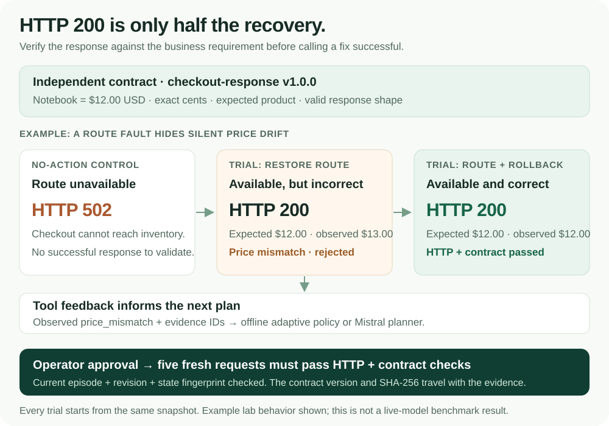

# Recovery means the checkout is correct

A service can return HTTP 200 and still charge the wrong amount. IncidentLab now
checks both availability and the returned business data before it recommends or
verifies a recovery plan.

The amounts in this diagram illustrate the implemented notebook scenario. They
are application requirements and example responses, not benchmark scores or a
claim about live Mistral performance.

## The requirement stays independent of the bug

[`contracts.py`](../../src/incidentlab/domain/contracts.py) defines the immutable
`checkout-response` contract, version `1.0.0`, separately from the SQLite catalog
and deployed pricing code. Its expected totals are notebook **$12.00**, lamp
**$45.00**, and mug **$8.50**, denominated in USD. A faulty application response
cannot redefine those expected prices.

| Contract check | What it rejects |
| --- | --- |
| Expected SKU and exact price in integer cents | The wrong product, incorrect total, or fractional-cent amount |
| Exactly `request_id`, `sku`, and `total` | Missing or unexpected fields, invalid field types, or an empty/oversized request ID |
| Strict, bounded JSON | Duplicate keys, malformed responses, nonstandard numeric constants, and oversized payloads |

The contract's version and SHA-256 are saved with each verification record. Its
definition also contributes to the snapshot fingerprint, so changing the
requirement after rehearsal invalidates the old plan's promotion authority.
Probe requests rotate through the contract's three products in a seeded order;
the default three-request experiment and five-request final verification cover
all three.

## A transport fix can reveal a business failure

Two scenarios exercise the distinction:

| Scenario | Observed behavior | Complete recovery plan |
| --- | --- | --- |
| `silent_price_drift` | Checkout returns HTTP 200 but the release adds $1.00 to each product total. | Roll back the checkout release. |
| `route_and_price_drift` | An invalid inventory route returns 502. Repairing only the route exposes the incorrect HTTP 200 totals. | Restore the route and roll back the release. |

Every experiment starts from an isolated copy of the same source state. The
combined plan therefore includes the route repair again; it does not inherit a
previous trial's changes. No rehearsal changes the active lab.

The verifier records three distinct outcomes:

| Field | Meaning |
| --- | --- |
| `all_http_healthy` | Every sampled request returned HTTP 200. |
| `semantic_passed` | Every sampled response satisfied the declared checkout contract. |
| `all_healthy` | Both availability and contract checks passed. |

Per-request `semantic_checks` retain the expected and observed totals, requested
and returned product IDs, HTTP status, request ID, and specific violations.
An HTTP error is a failed request; it is not presented as a successful semantic
check. The frontend separates HTTP failures from incorrect business outcomes
and shows expected-versus-observed values alongside the measured plans. Older
records without contract checks remain identifiable as HTTP-only evidence.

## The planner learns from measured tool feedback

The adaptive loop receives observations from its control and previous isolated
experiments. A `price_mismatch` observation supplies the expected and observed
amounts plus a citable evidence ID. The offline policy maps that observed error
to a release rollback. The Mistral adapter supplies the same measured feedback
and the actual effects of the allowlisted actions to the model.

The live model can request another `rehearse_plan` or `stop_rehearsal`. It cannot
declare its own response correct, change the contract, run arbitrary commands,
or promote a plan. The independent verifier decides whether an experiment
passed. Scenario labels and evaluator answer keys remain outside model context.

The interface retains the decision trail, measured business failures, selected
plan, contract metadata, and provider usage. Operator promotion still requires a
current episode, revision, and snapshot fingerprint. Five fresh requests in the
active lab must then pass both checks.

## Demonstration and evaluation

The [README walkthrough](../../README.md#try-the-demo) covers the route-only
false recovery, combined repair, optional Recovery Proof, and fresh verification.
It also includes budget experiments and no-action controls.

The [semantic evaluation protocol](../evaluation/semantic-evaluation.md)
separately measures HTTP-only versus contract-aware acceptance on identical
saved responses and policy recovery in independent labs. It contains commands,
manifest details, denominators, provider usage, and retained unsuccessful live
runs. These results do not assign offline policy performance to Mistral.

This verifies the declared rules for a small local HTTP/SQLite application.
Undeclared business requirements, long-term reliability, external side effects,
and production rollout safety remain outside that result. A versioned contract
is only as useful as the requirements it accurately represents.

[Project overview](../../README.md) · [Adaptive recovery design](../career/mistral-fde.md) ·
[Architecture](overview.md)
